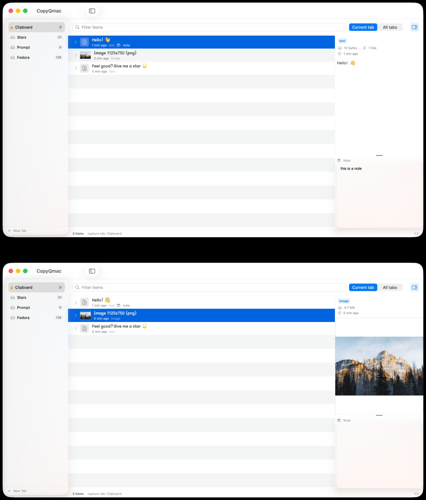

[English](README.md) | [简体中文](README_CN.md)

# CopyQ Mac

[](https://github.com/SimonWXH/copyqmac/actions/workflows/ci.yml)
[](LICENSE)
[](#requirements)

A native clipboard manager for macOS, written in Swift and SwiftUI - a real AppKit
application rather than a port of a Qt one, sharing the clipboard history format of
[CopyQ](https://github.com/hluk/CopyQ) so the same history can be used on a Mac and on
a Linux machine.



CopyQ Mac keeps a searchable history of the things you copy, minus a short list of
exclusions, and lets you organise it into tabs, with notes and pins on each entry and
optional two-way syncing through a folder. Copying is captured faithfully: text, rich
text, HTML, images, files and custom pasteboard types are stored with their exact
bytes, so pasting an entry back reproduces what was originally copied rather than an
approximation of it.

## Features

### Capture

- Every non-empty pasteboard change is recorded with all of its flavours, keyed by
  type identifier, unless one of the privacy rules below excludes it or no source app
  can be attributed to the copy. An entry pasted back to the system clipboard is
  byte-identical to what was captured.
- Text, rich text, HTML, file URLs, images and unknown custom types are all kept.
  Any decodable image flavour can be previewed, including PNG, TIFF, JPEG, HEIC and
  GIF.
- Rich text is shown as it was copied: stored fonts, headings and colours are drawn in
  both the list and the preview, adapted for light and dark appearance.
- Files copied in Finder appear under their file name, the way CopyQ shows them, and
  paste back as the real file.
- Ignored apps keep password managers out of the history and out of the sync folder
  for captures made on this machine. The list starts enabled with 1Password,
  1Password 7, Bitwarden, Keychain Access, Passwords, KeePassXC, LastPass, Dashlane
  and Enpass; each rule can be switched off or removed, and the last app you copied
  from can be added in Preferences ▸ Ignored Apps. A capture that its source marks
  concealed, transient or auto-generated is skipped too. Items arriving through a
  sync folder are not filtered.
- A configurable guard keeps API keys for common AI services out of the history and
  out of the sync folder, within limits: it checks copies made on this machine only,
  it does not filter items arriving through a sync folder, and it matches a fixed
  table of key shapes rather than scanning for secrets in general.

### Tabs, notes and syncing

- Create, rename, reorder and remove tabs, and choose which tab captures made on this
  machine are written into.
- Every entry has a note, edited with `⌘E`, saved as you type and included in search.
- A tab's sync folder is the only sync control: point a tab at a folder and it imports
  from it and writes captures, new items and edits back to it; leave it empty and the
  tab stays local.
- The sync folder uses CopyQ's own itemsync format, so a tab and a CopyQ installation
  on another machine can share one history. Edits are resolved by timestamp, and a
  remote edit that overwrites local content is logged rather than silently lost.
- An existing CopyQ history can be imported from the File menu; the [feature
  reference](docs/features.md) covers both import commands.
- Deletions move the affected group into a local trash that is never synced, instead
  of hard-deleting files in a shared folder.

### Editing and search

- Edit an entry's text with `fn`-`F2` (plain `F2` with "Use F1, F2, etc. keys as
  standard function keys" enabled; `⌘E` still edits the note); new text is typed in
  the editor font set in Preferences, while a payload's own formatting is preserved.
- Saving an edit also rewrites that entry's file group in the sync folder, so the
  other machine updates the same item instead of seeing a duplicate.
- Case-insensitive substring search, including CJK text, file names and paths, scoped
  to the current tab or across all tabs.

### Keyboard and paste-back

- Two global shortcuts, registered through Carbon so they need no Accessibility
  permission: `⌥V` summons the window, and `⇧⌘V` pastes as plain text. Both are
  configurable, and Preferences reports a conflict when another application already
  owns the combination.
- Activating an entry copies it, returns focus to the previous application and pastes.
  The steps are configurable and run in a fixed order. In the history window,
  `⌘1` through `⌘9` activate the item with that list number; plain `1` through
  `9` do the same while the search field is empty.
- Paste as plain text strips every rich flavour, from the selected entry when the
  window is open and from the live clipboard otherwise.
- Multi-selection with `⌘`-click, `⇧`-click and `⌘A`, bulk delete through the trash,
  reordering within pin groups, and moving entries to another tab by dragging them
  onto its tab.

### Window and appearance

- Two window layouts, switchable at runtime in Preferences ▸ History ▸ Appearance: a classic
  arrangement with tabs across the top and a bottom preview pane, and a sidebar layout
  with a collapsible tab sidebar, a unified toolbar and a trailing inspector that resizes
  from its leading edge and remembers the chosen width, its preview and note sharing one
  column through a draggable divider. Item text wraps to fit a narrower list,
  up to six lines.
- Light and dark appearance, either following the system or pinned manually.
- Bilingual interface, English and 简体中文, switchable in Preferences.

See [full detail](docs/features.md) for complete feature documentation, implementation rules and edge cases.

## Relationship to CopyQ

CopyQ Mac is an independent Swift implementation that follows CopyQ's behaviour and
reads and writes its clipboard data formats, so one history can move between the two.
It is not an official CopyQ product and is not affiliated with or endorsed by the
CopyQ project. Any part of the implementation that is a port or translation of CopyQ
source remains under GPL-3.0; attribution is recorded in NOTICE.

Not implemented: CopyQ's JavaScript command and scripting API, its Qt plugin system,
encryption, network features, and cross-platform builds. CopyQ Mac runs on macOS
only.

## Requirements

- macOS 26 or later. The prebuilt disk image is Apple silicon only; Intel Macs
  build from source (see [Installation](#installation)).
- The Swift toolchain and macOS SDK. The Command Line Tools are enough: a full Xcode
  installation is neither needed to build, sign and run the app, nor needed for the
  test suite.
- No Apple Developer account. Local builds and published releases are signed
  ad hoc.
- Accessibility permission is optional, and only needed for automatic paste-back.

## Installation

Pre-built disk images (`.dmg`) are available on the
[Releases](https://github.com/SimonWXH/copyqmac/releases) page.

1. Download `CopyQMac-<version>.dmg` from the latest release. The disk image is
   Apple silicon only; on an Intel Mac, build from source instead with `make build`
   (see [Build](#build)).
2. Open the disk image and drag **CopyQmac** into `/Applications`.
3. Complete the first-launch authorization (see below).
4. Grant Accessibility permission only if you want automatic paste-back; copying and
   recording history work without it. The [release
   notes](https://github.com/SimonWXH/copyqmac/releases) for the release you download
   have the exact steps for both.

### First launch (ad-hoc signed build)

Release builds are ad-hoc signed and not notarized, as CopyQmac is developed without
an Apple Developer account, so macOS blocks the first launch of a downloaded copy. The
exact authorization steps are in the [release
notes](https://github.com/SimonWXH/copyqmac/releases) for the release you download.

## Build

```sh
make build    # compile and assemble CopyQmac.app
make test     # run the headless test suite and re-assert a built bundle
make run      # launch the built app
make clean
```

To install the app, copy the built bundle to `/Applications` (remove any existing
bundle first so `ditto` does not merge over stale bundle content):

```sh
make build
rm -rf /Applications/CopyQmac.app
ditto build/CopyQmac.app /Applications/CopyQmac.app
```

Because the bundle is signed ad hoc, macOS ties the Accessibility grant to the exact
binary, so every rebuild or update needs it re-established; [Granting
Accessibility](docs/build.md#granting-accessibility) has the steps.

[`docs/build.md`](docs/build.md) covers the build in more detail, and [`docs/architecture.md`](docs/architecture.md) describes
how the pieces fit together.

## Project layout

```
app/          SwiftUI and AppKit application sources
core/         Clipboard model, storage, tabs, preferences and search (AppKit-free)
tests/        Headless test suite
tools/        Build and asset tooling, including the app icon generator
docs/         Feature reference, build notes, architecture and screenshots
resources/    App icon shipped in the bundle
```

## Licence

GNU General Public License v3.0. CopyQ Mac is behaviourally modelled on
[CopyQ](https://github.com/hluk/CopyQ), which is also GPL-3.0; see [`NOTICE`](NOTICE)
for attribution.
