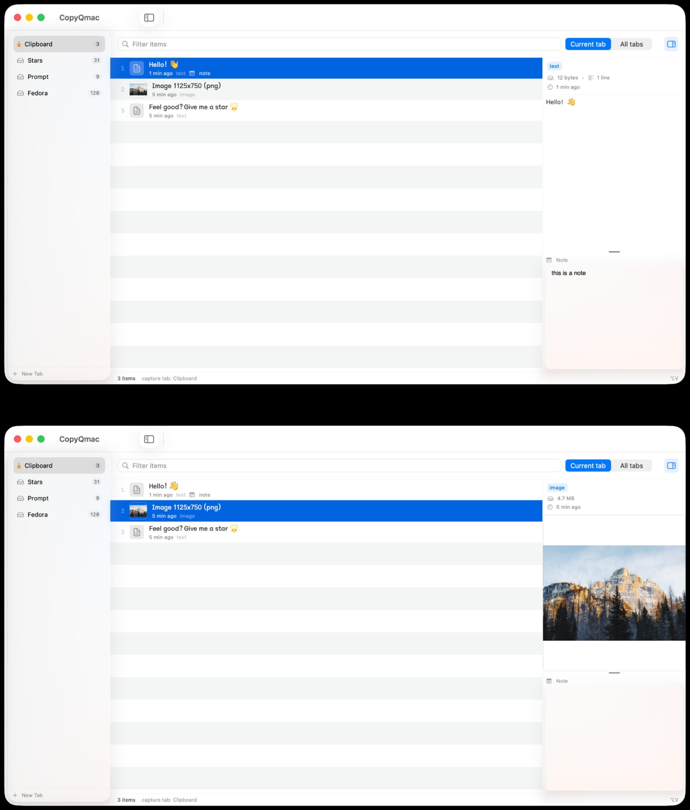

[English](README.md) | [简体中文](README_CN.md)

# CopyQ Mac

[](https://github.com/SimonWXH/copyqmac/actions/workflows/ci.yml)
[](LICENSE)
[](#系统要求)

一款专为 macOS 打造的原生剪贴板管理器，采用 Swift 与 SwiftUI 编写 - 它是真正的 AppKit 原生应用而非 Qt 移植版本，并兼容 [CopyQ](https://github.com/hluk/CopyQ) 的剪贴板历史格式，同一份历史记录可在 Mac 与 Linux 设备间直接通用。



CopyQ Mac 会在排除忽略列表中的特定内容后，完整保留可随时搜索的复制历史。你可以通过标签页对历史进行分类整理，为每条记录添加备注或置顶固定，还能通过同步文件夹实现可选的双向同步。所有复制内容均被忠实捕获：无论是纯文本、富文本、HTML、图片、文件还是自定义剪贴板类型，都会以原始字节完整保存；再次粘贴时即可精准还原最初复制的内容，绝非粗略的近似替代。

## 功能特性

### 捕获

- 只要未被下述隐私规则排除，且能追溯到来源应用，剪贴板的每一次非空变动都会按类型标识符（type identifier）记录下其所有的 flavour。重新粘贴到系统剪贴板的内容与最初捕获的原始字节完全一致。
- 文本、富文本、HTML、文件 URL、图片以及未知的自定义类型均会保留。支持预览所有可解码的图像 flavour，包括 PNG、TIFF、JPEG、HEIC 与 GIF。
- 富文本会按复制时的原始样式呈现：列表中和预览窗格中都会绘制存储的字体、标题与颜色，并自动适配浅色和深色外观。
- 在 Finder 中复制的文件会以其文件名显示（与 CopyQ 的呈现方式一致），并能作为真实文件粘贴回去。
- 忽略列表可防止密码管理器中的内容被写入本机历史记录和同步文件夹。默认预设并启用的应用包括 1Password、1Password 7、Bitwarden、Keychain Access、Passwords、KeePassXC、LastPass、Dashlane 以及 Enpass；每条规则均可单独停用或删除，在“偏好设置 ▸ 已忽略的应用”（Preferences ▸ Ignored Apps）中还可以直接添加最近一次复制所来自的应用。若来源应用将复制内容标记为 concealed、transient 或 auto-generated，也会被自动忽略。通过同步文件夹同步过来的条目则不受此过滤限制。
- 可通过配置防护规则，防止常见 AI 服务的 API Key 进入历史记录和同步文件夹。该防护具有一定边界：仅对本机的复制操作生效，不会过滤通过同步文件夹接收的条目，且它是基于固定格式特征库进行匹配，而非通用的敏感凭据扫描。

### 标签页、备注与同步

- 支持创建、重命名、重新排序及删除标签页，并可指定本机捕获的内容默认写入哪个标签页。
- 每条记录都可添加备注，使用快捷键 `⌘E` 进行编辑，边输入边保存，且备注内容支持全文搜索。
- 标签页的同步文件夹是唯一的同步配置项：为标签页指定一个文件夹后，它会自动导入其中的条目，并将新捕获的内容、新建项与修改写回该文件夹；若留空，则该标签页仅保存在本地。
- 同步文件夹采用 CopyQ 原生的 itemsync 格式，因此标签页可与其它设备上安装的 CopyQ 共享同一套历史记录。修改冲突依据时间戳进行合并解决；若远端修改覆盖了本地内容，系统会记录日志而非静默丢失。
- 可从“文件”（File）菜单导入现有的 CopyQ 历史记录；[功能参考文档（英文）](docs/features.md)详细介绍了这两种导入命令。
- 删除操作会将受影响的条目组移入从不同步的本地废纸篓，而不会直接硬删除共享文件夹中的文件。

### 编辑与搜索

- 使用快捷键 `fn`-`F2` 编辑条目的文本（若系统启用了“将 F1、F2 等键用作标准功能键”，则直接按 `F2`；`⌘E` 仍用于编辑备注）；新文本以偏好设置中指定的编辑器字体输入，同时保留载荷自身的原始格式。
- 保存修改时会同时重写同步文件夹中该条目对应的文件组，使另一台设备能够直接更新同一条目，而不会产生重复项。
- 支持不区分大小写的子字符串搜索，涵盖中日韩（CJK）文字、文件名及路径，搜索范围可限定为当前标签页或全部标签页。

### 快捷键与自动粘贴

- 通过 Carbon 注册了两个全局快捷键，无需辅助功能（Accessibility）权限：`⌥V` 用于唤起窗口，`⇧⌘V` 用于以纯文本形式粘贴。两个快捷键均可自定义，当其它应用已占用该按键组合时，偏好设置会提示冲突。
- 激活某条记录会自动将其复制、将焦点切回前一个应用并执行粘贴。这些步骤支持自定义，并按固定顺序执行。
- 以纯文本粘贴会剥离所有富文本 flavour：窗口打开时作用于当前选中的条目，窗口未打开时则作用于系统当前的实时剪贴板内容。
- 支持使用 `⌘`-点击、`⇧`-点击及 `⌘A` 进行多选，可通过废纸篓批量删除，支持在置顶分组内重新排序，也可直接将条目拖拽到对应标签页以移动分类。

### 窗口与外观

- 提供两种窗口布局，可在“偏好设置 ▸ 历史记录 ▸ 外观”（Preferences ▸ History ▸ Appearance）中实时切换：一种是经典的顶部标签页加底部预览窗格布局；另一种是侧边栏布局，配备可折叠的标签页侧边栏、整合式统一工具栏，以及右侧检查器（预览与备注通过可拖动的分割线共用一列）。
- 支持浅色与深色外观，可跟随系统自动切换或手动固定。
- 支持双语界面（English 与 简体中文），可在偏好设置中随时切换。

更完整的功能说明、实现规则与边缘情况处理，详见[功能文档（英文）](docs/features.md)。

## 与 CopyQ 的关系

CopyQ Mac 是一个独立的 Swift 实现，它遵循 CopyQ 的操作行为，并读写其剪贴板数据格式，使同一份历史记录可以在两者之间无缝迁移。它不是 CopyQ 的官方产品，也未获得 CopyQ 项目的附属关联或背书认可。实现中凡移植或转译自 CopyQ 源码的部分，均继续遵循 GPL-3.0 协议；相关署名记录在 `NOTICE` 中。

暂未实现的功能：CopyQ 的 JavaScript 命令与脚本 API、Qt 插件系统、加密、网络特性以及跨平台构建。CopyQ Mac 仅运行于 macOS。

## 系统要求

- macOS 26 或更高版本，支持 Apple 芯片或 Intel 处理器。
- Swift 工具链与 macOS SDK。仅需安装 Command Line Tools 即可：构建、签名、运行应用以及运行测试套件均无需安装完整的 Xcode。
- 无需 Apple 开发者账号。本地使用均采用临时代码签名（ad-hoc 签名）。
- 辅助功能（Accessibility）权限为可选项，仅在需要自动回贴时才需要开启。

## 构建

```sh
make build    # 构建并打包 CopyQmac.app
make test     # 运行无头测试套件
make run      # 启动构建好的应用
make clean
```

如需安装该应用，将构建生成的 bundle 复制到 `/Applications` 即可（复制前先删除已有 bundle，以免 `ditto` 合并进上一次构建残留的内容）：

```sh
make build
rm -rf /Applications/CopyQmac.app
ditto build/CopyQmac.app /Applications/CopyQmac.app
```

由于应用采用临时签名（ad-hoc），macOS 会将辅助功能授权与具体的可执行文件绑定，因此每次重新构建或更新都需要重新授权；具体操作步骤见[授予辅助功能权限](docs/build.md#granting-accessibility)。

[`docs/build.md`](docs/build.md) 详细介绍了构建流程，[`docs/architecture.md`](docs/architecture.md) 则阐述了各模块的设计与架构协同方式。

## 项目结构

```
app/          SwiftUI 与 AppKit 应用源码
core/         剪贴板模型、存储、标签页、偏好设置与搜索（不依赖 AppKit）
tests/        无头测试套件
tools/        构建与资源工具，包括应用图标生成器
docs/         功能参考文档、构建说明、架构与截图
resources/    随应用分发的图标
```

## 许可证

遵循 GNU 通用公共许可证 v3.0（GPL-3.0）。CopyQ Mac 在行为模式上借鉴了同样采用 GPL-3.0 协议的 [CopyQ](https://github.com/hluk/CopyQ)；署名信息参见 [`NOTICE`](NOTICE)。
